# 🏢 RealEstate Manager

Hệ thống quản lý bất động sản full-stack: quản lý nguồn hàng, khách hàng, lịch xem nhà, giao dịch và dashboard thống kê doanh thu. Có phân quyền **ADMIN / AGENT**, xác thực JWT (access + refresh token xoay vòng) và chạy toàn bộ bằng một lệnh `docker compose up`.

[](https://github.com/ducpham04/realestate-management/actions/workflows/ci.yml)

| Tầng | Công nghệ |
|------|-----------|
| Backend | Java 21, Spring Boot 3.5, Spring Security + JWT, Spring Data JPA, MySQL 8, Flyway, MapStruct, Lombok, springdoc-openapi |
| Frontend | React 18, Vite, TypeScript, Tailwind CSS, TanStack React Query, React Router, React Hook Form + Zod, Recharts |
| Test | JUnit 5, Mockito, Testcontainers (MySQL), MockMvc, Vitest, Testing Library |
| DevOps | Docker (multi-stage), docker-compose, Nginx, GitHub Actions |

---

## Mục lục

- [Ảnh chụp màn hình](#ảnh-chụp-màn-hình)
- [Kiến trúc](#kiến-trúc)
- [Chạy nhanh với Docker](#chạy-nhanh-với-docker)
- [Tài khoản demo](#tài-khoản-demo)
- [Phát triển local](#phát-triển-local)
- [API](#api)
- [Phân quyền](#phân-quyền)
- [Kiểm thử](#kiểm-thử)
- [Quyết định thiết kế](#quyết-định-thiết-kế)

---

## Ảnh chụp màn hình

> Ảnh trong `docs/screenshots/` được chụp tự động bằng Playwright. Môi trường chụp không truy cập được Unsplash nên ảnh bất động sản hiển thị ảnh thay thế (placeholder); khi chạy thật, ảnh sẽ tải bình thường. Bạn có thể thay bằng ảnh của riêng mình.

| Dashboard | Bất động sản |
|-----------|--------------|
| 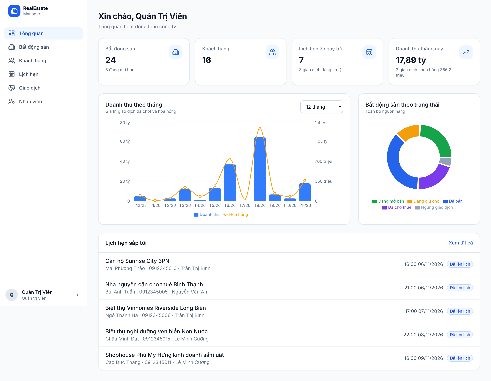 | 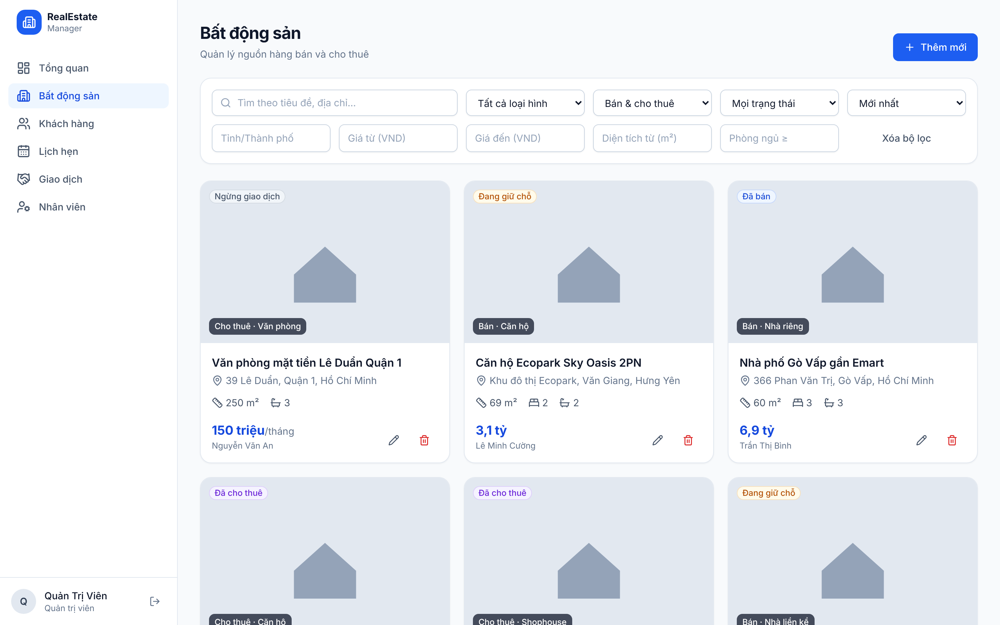 |

| Giao dịch | Lịch hẹn |
|-----------|----------|
| 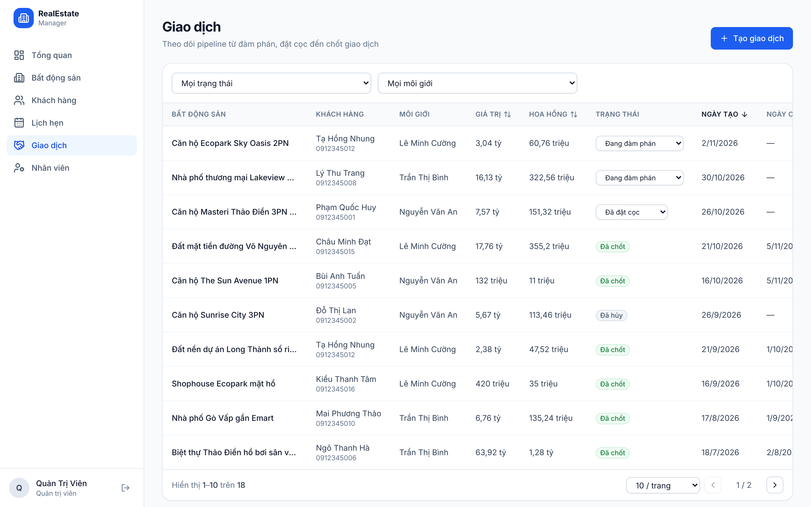 | 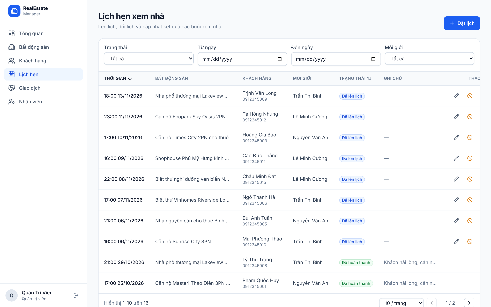 |

| Đăng nhập | Khách hàng | Mobile |
|-----------|------------|--------|
| 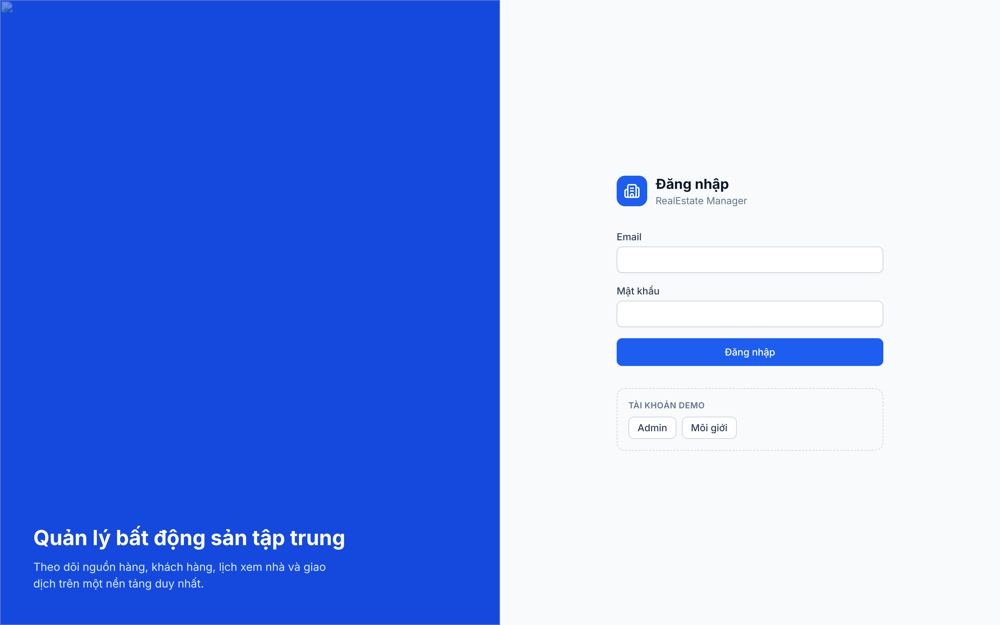 | 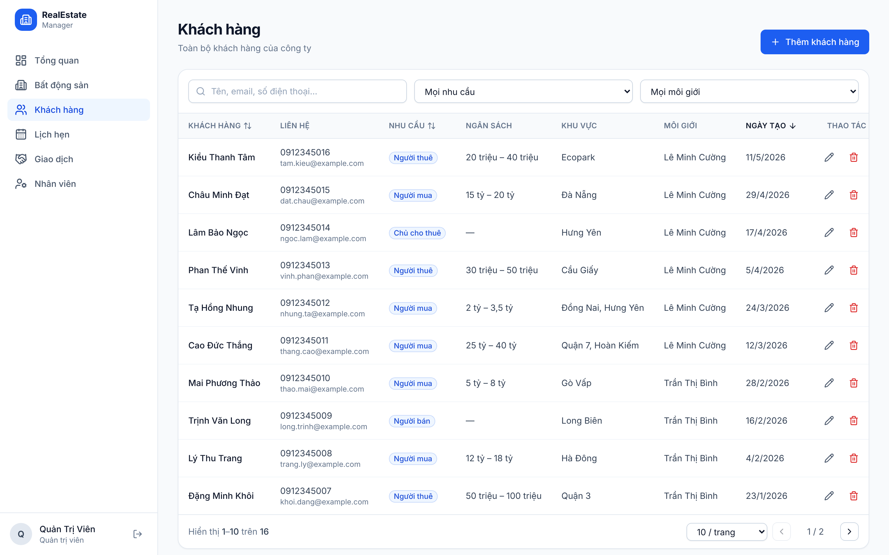 | 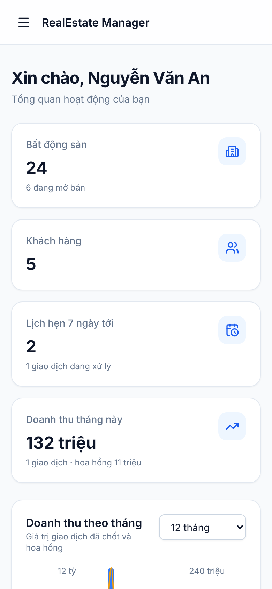 |

---

## Kiến trúc

### Tổng quan triển khai

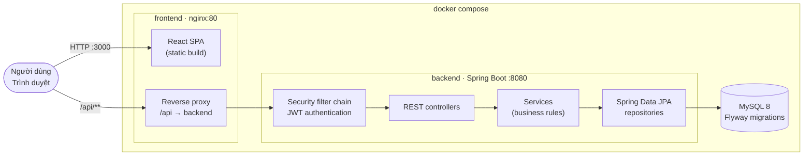

Trình duyệt chỉ nói chuyện với **một origin** (nginx), nginx chuyển tiếp `/api/**` tới backend → không cần cấu hình CORS trong môi trường production.

### Cấu trúc backend (package theo tính năng)

```
backend/src/main/java/com/realestate
├── auth/          # login, refresh (rotation), logout, RefreshToken entity
├── security/      # JwtService, JwtAuthenticationFilter, UserPrincipal, xử lý lỗi 401/403
├── user/          # User, Role, quản lý nhân viên
├── property/      # Property, Address, Specification tìm kiếm động
├── customer/      # Customer
├── appointment/   # Appointment (lịch xem nhà, chống trùng lịch)
├── deal/          # Deal (state machine + đồng bộ trạng thái BĐS)
├── dashboard/     # thống kê tổng hợp
├── common/        # ApiResponse, PageResponse, SortSanitizer, exception handler, BaseEntity
└── config/        # Security, OpenAPI, JPA auditing, Clock
```

Mỗi tính năng gồm `Entity → Repository → Service → Controller` + `dto/` + `Mapper` (MapStruct). Controller mỏng, toàn bộ quy tắc nghiệp vụ và kiểm tra quyền sở hữu nằm ở Service.

### Mô hình dữ liệu

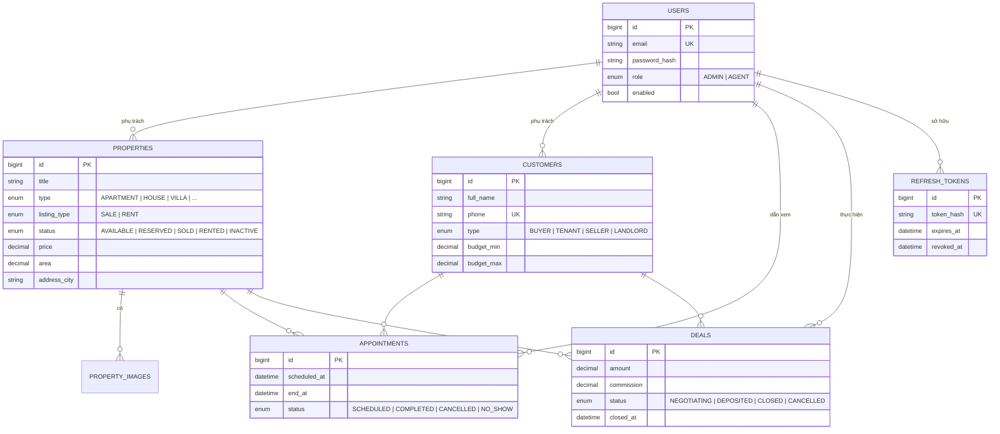

### Vòng đời giao dịch và trạng thái BĐS

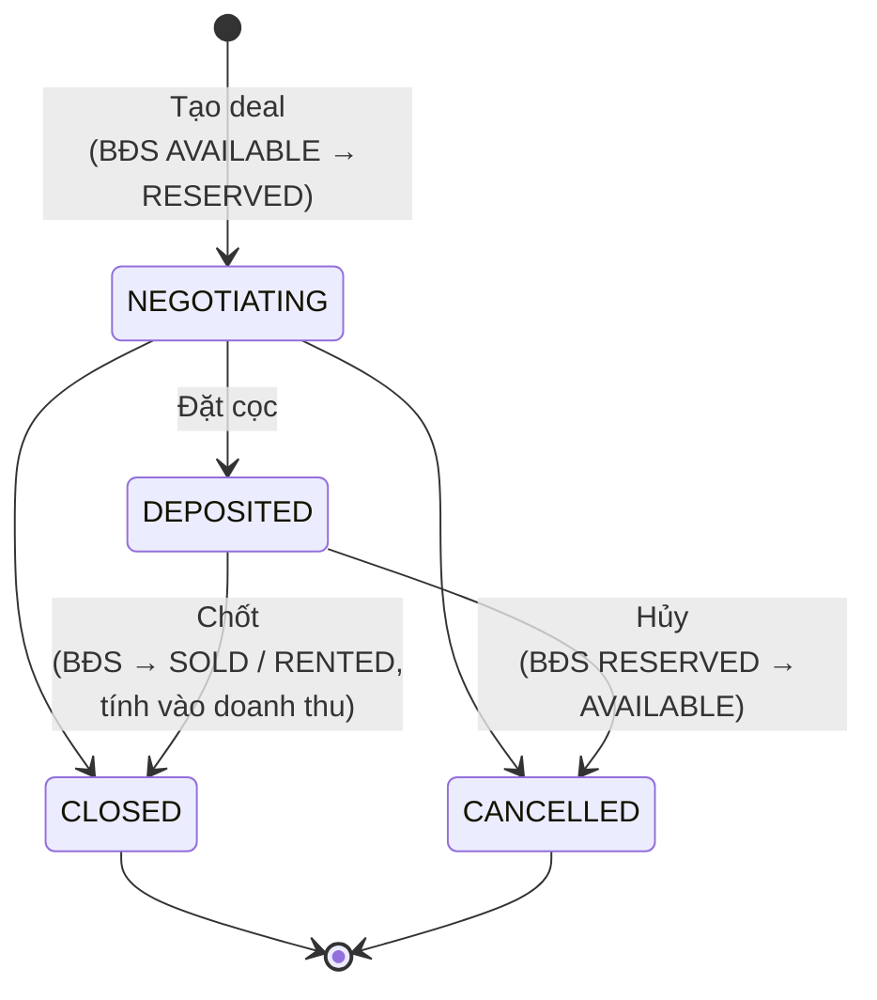

### Luồng xác thực và refresh token tự động

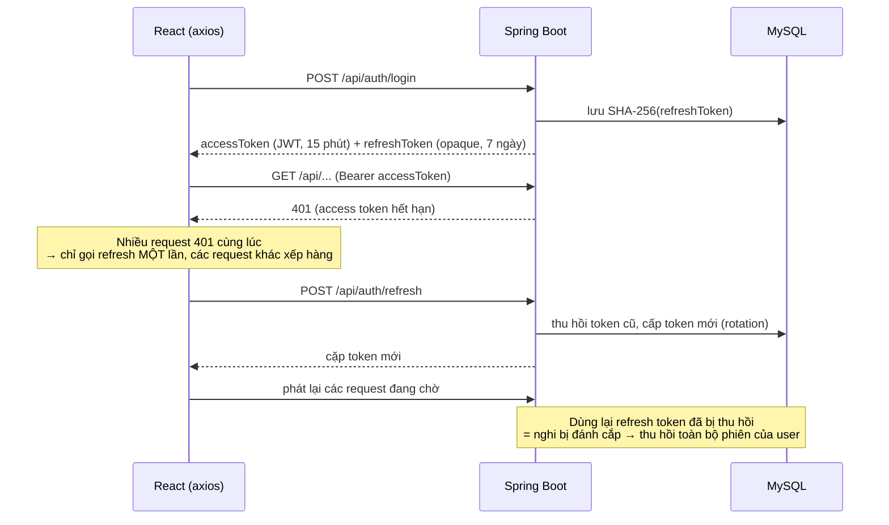

---

## Chạy nhanh với Docker

Yêu cầu: Docker 24+ với Docker Compose v2.

```bash
git clone https://github.com/ducpham04/realestate-management.git
```

```bash
cd realestate-management
```

```bash
docker compose up -d --build
```

| Dịch vụ | URL |
|---------|-----|
| Ứng dụng web | http://localhost:3000 |
| Swagger UI | http://localhost:3000/swagger-ui.html (hoặc http://localhost:8080/swagger-ui.html) |
| REST API | http://localhost:8080/api |
| Health check | http://localhost:8080/actuator/health |
| MySQL | `localhost:3306` (user/pass: `realestate` / `realestate`) |

Lần chạy đầu tiên Flyway tự tạo schema và nạp dữ liệu mẫu (24 BĐS, 16 khách hàng, 16 lịch hẹn, 18 giao dịch rải đều trong 12 tháng gần nhất để biểu đồ có dữ liệu).

Cấu hình qua biến môi trường: sao chép `.env.example` thành `.env` và chỉnh sửa. **Luôn đổi `JWT_SECRET` khi triển khai thật:**

```bash
openssl rand -base64 32
```

Dừng và xóa dữ liệu:

```bash
docker compose down -v
```

---

## Tài khoản demo

| Vai trò | Email | Mật khẩu |
|---------|-------|----------|
| ADMIN | `admin@realestate.com` | `Admin@123` |
| AGENT | `agent1@realestate.com` | `Agent@123` |
| AGENT | `agent2@realestate.com` | `Agent@123` |
| AGENT | `agent3@realestate.com` | `Agent@123` |

Trang đăng nhập có nút điền nhanh tài khoản demo.

---

## Phát triển local

**Backend** (cần Java 21, Maven 3.9 và một MySQL đang chạy):

```bash
docker compose up -d mysql
```

```bash
cd backend && mvn spring-boot:run
```

**Frontend** (cần Node 20+; Vite proxy `/api` → `http://localhost:8080`):

```bash
cd frontend && npm install && npm run dev
```

Mở http://localhost:5173.

| Biến môi trường backend | Mặc định | Mô tả |
|-------------------------|----------|-------|
| `DB_URL` | `jdbc:mysql://localhost:3306/realestate...` | JDBC URL |
| `DB_USERNAME` / `DB_PASSWORD` | `realestate` / `realestate` | |
| `JWT_SECRET` | *(khóa dev)* | Khóa HMAC base64, tối thiểu 256 bit |
| `JWT_ACCESS_TTL` | `15m` | Thời hạn access token |
| `JWT_REFRESH_TTL` | `7d` | Thời hạn refresh token |
| `CORS_ALLOWED_ORIGINS` | `http://localhost:5173,http://localhost:3000` | |

---

## API

Tài liệu đầy đủ ở Swagger UI. Mọi response dùng chung một envelope:

```json
{
  "success": true,
  "message": "OK",
  "data": { "content": [ ], "page": 0, "size": 10, "totalElements": 24, "totalPages": 3, "first": true, "last": false },
  "timestamp": "2026-11-05T06:17:10.857Z"
}
```

Lỗi validation:

```json
{
  "success": false,
  "message": "Validation failed",
  "errorCode": "VALIDATION_FAILED",
  "errors": [{ "field": "price", "message": "must be greater than 0.0" }],
  "timestamp": "..."
}
```

| Nhóm | Endpoint |
|------|----------|
| Auth | `POST /api/auth/login`, `POST /api/auth/refresh`, `POST /api/auth/logout`, `GET /api/auth/me` |
| Users | `GET/POST /api/users`, `GET/PUT /api/users/{id}`, `GET /api/users/agents`, `PUT /api/users/me/password` |
| Properties | `GET/POST /api/properties`, `GET/PUT/DELETE /api/properties/{id}`, `PATCH /api/properties/{id}/status` |
| Customers | `GET/POST /api/customers`, `GET/PUT/DELETE /api/customers/{id}` |
| Appointments | `GET/POST /api/appointments`, `GET/PUT/DELETE /api/appointments/{id}`, `PATCH /api/appointments/{id}/status` |
| Deals | `GET/POST /api/deals`, `GET/PUT/DELETE /api/deals/{id}`, `PATCH /api/deals/{id}/status` |
| Dashboard | `GET /api/dashboard/summary`, `GET /api/dashboard/properties-by-status`, `GET /api/dashboard/revenue-by-month?months=12` |

**Tìm kiếm, lọc, phân trang, sắp xếp**, ví dụ:

```
GET /api/properties?keyword=vinhomes&type=APARTMENT&listingType=SALE&status=AVAILABLE
    &city=Hồ Chí Minh&minPrice=2000000000&maxPrice=8000000000&minArea=50&minBedrooms=2
    &page=0&size=12&sort=price,desc
```

Trường sắp xếp được kiểm tra theo whitelist (ví dụ `sort=agent.password` → 400), `size` tối đa 100.

| HTTP | `errorCode` | Khi nào |
|------|-------------|---------|
| 400 | `VALIDATION_FAILED`, `BAD_REQUEST` | Dữ liệu/tham số không hợp lệ |
| 401 | `UNAUTHORIZED`, `INVALID_CREDENTIALS`, `INVALID_TOKEN` | Chưa đăng nhập, sai mật khẩu, token hết hạn/bị thu hồi |
| 403 | `FORBIDDEN`, `ACCOUNT_DISABLED` | Không đủ quyền, tài khoản bị khóa |
| 404 | `RESOURCE_NOT_FOUND` | Không tồn tại (hoặc thuộc agent khác) |
| 409 | `CONFLICT` | Trùng email/SĐT, trùng lịch hẹn, xóa bản ghi đang được tham chiếu |
| 422 | `BUSINESS_RULE_VIOLATION` | Vi phạm quy tắc nghiệp vụ (chuyển trạng thái sai, BĐS đã bán...) |

---

## Phân quyền

| Chức năng | ADMIN | AGENT |
|-----------|:-----:|:-----:|
| Xem toàn bộ BĐS | ✅ | ✅ |
| Thêm BĐS | ✅ (gán cho bất kỳ agent) | ✅ (tự gán cho mình) |
| Sửa BĐS | ✅ | ✅ chỉ BĐS mình phụ trách |
| Xóa BĐS | ✅ | ❌ |
| Khách hàng / lịch hẹn / giao dịch | ✅ tất cả | ✅ chỉ của mình |
| Xóa giao dịch (chưa chốt) | ✅ | ❌ |
| Dashboard | Toàn công ty | Số liệu của mình (BĐS: toàn công ty) |
| Quản lý nhân viên | ✅ | ❌ |

Phân quyền được thực thi ở **backend** (`@PreAuthorize` + kiểm tra quyền sở hữu trong service). Agent truy cập bản ghi của agent khác nhận **404** chứ không phải 403, để không tiết lộ bản ghi có tồn tại. Frontend chỉ ẩn/hiện giao diện (`RoleGate`, `RequireRole`) cho trải nghiệm tốt hơn.

**Quy tắc nghiệp vụ chính**
- Lịch hẹn: thời gian phải ở tương lai; một agent không thể có hai lịch trùng giờ; không đặt lịch cho BĐS đã bán/cho thuê/ngừng giao dịch; chỉ đánh dấu *hoàn thành* / *vắng mặt* sau giờ hẹn.
- Giao dịch: chỉ mở trên BĐS `AVAILABLE`, mỗi BĐS tối đa một giao dịch đang hoạt động; trạng thái BĐS tự đồng bộ theo giao dịch; giao dịch đã chốt không thể sửa/xóa.
- BĐS/khách hàng đã có lịch hẹn hoặc giao dịch không thể xóa (giữ lịch sử doanh thu); thay vào đó chuyển BĐS sang `INACTIVE`.
- Optimistic locking (`@Version`) trên mọi entity.

---

## Kiểm thử

```bash
cd backend && mvn verify
```

- **69 unit test** (JUnit 5 + Mockito, dùng MapStruct mapper thật) cho mọi service: Property, Customer, Appointment, Deal, Dashboard, Auth, User, JwtService.
- **38 integration test** controller (`@SpringBootTest` + MockMvc + **Testcontainers MySQL 8**): chạy migration Flyway thật, kiểm tra end-to-end xác thực, rotation/reuse detection của refresh token, phân quyền, validation, tìm kiếm/lọc/sắp xếp, vòng đời giao dịch ảnh hưởng tới dashboard. Cần Docker đang chạy.

```bash
cd frontend && npm run lint && npm test && npm run build
```

- **13 test Vitest**: interceptor refresh token (nhiều request 401 đồng thời chỉ refresh một lần, refresh thất bại thì đăng xuất), route guard theo vai trò, các hàm format.

GitHub Actions (`.github/workflows/ci.yml`) chạy toàn bộ test backend + frontend, build image Docker và smoke test `docker compose up` cho mỗi push/PR.

---

## Quyết định thiết kế

- **Access token stateless + refresh token opaque lưu DB.** Access token JWT ngắn hạn (15 phút) nên request thường không cần truy vấn DB. Refresh token là chuỗi ngẫu nhiên 384-bit, chỉ lưu **hash SHA-256**, được xoay vòng mỗi lần dùng; dùng lại token cũ sẽ thu hồi toàn bộ phiên của user (phát hiện token bị đánh cắp).
- **Lưu token ở `localStorage`** để đơn giản hóa demo. Ở production nên chuyển refresh token sang cookie `HttpOnly; Secure; SameSite=Strict` để giảm rủi ro XSS. Interceptor đã được tách biệt nên thay đổi này chỉ ảnh hưởng `tokenStorage.ts` và `AuthController`.
- **Flyway quản lý schema** (`ddl-auto: validate`): Hibernate chỉ kiểm tra entity khớp schema, không bao giờ tự thay đổi DB.
- **Doanh thu theo tháng** tính bằng native query `GROUP BY DATE_FORMAT(closed_at, '%Y-%m')` rồi bổ sung các tháng 0 đồng ở service, nên biểu đồ luôn liên tục.
- **`Clock` được inject** vào mọi service phụ thuộc thời gian → unit test xác định, không flaky.
- **Tiền tệ dùng `DECIMAL(15,2)` / `BigDecimal`**, không dùng số thực.
- **Nginx reverse proxy** cho phép frontend và API cùng origin; bundle được chia chunk (React, Recharts) và lazy-load theo trang.
